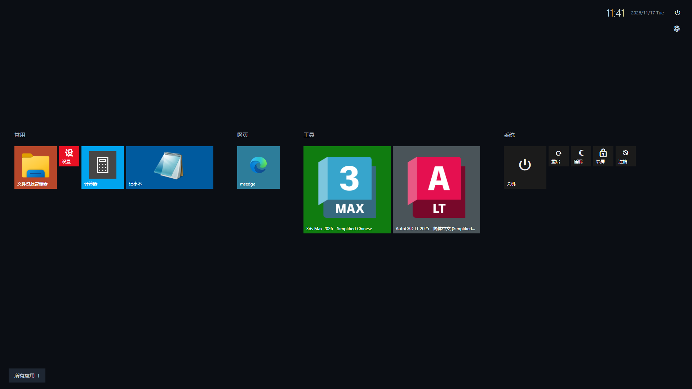
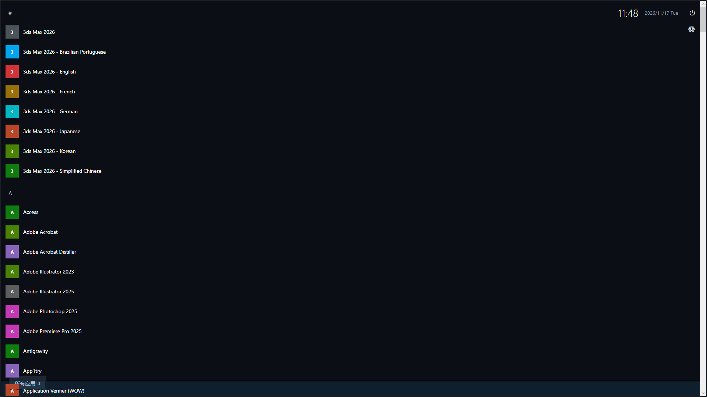
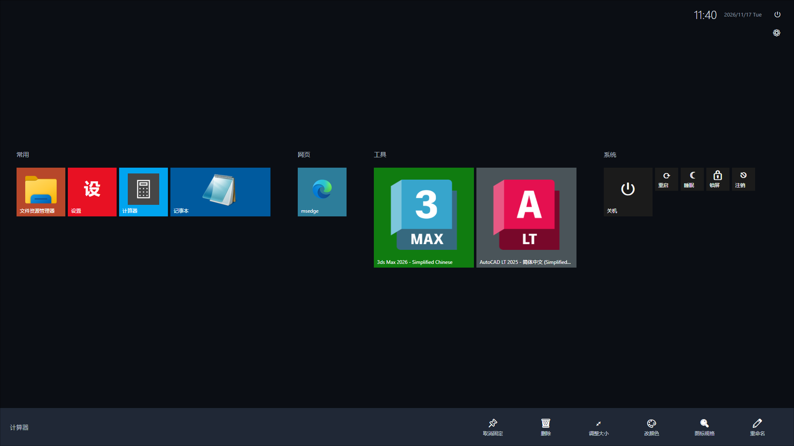
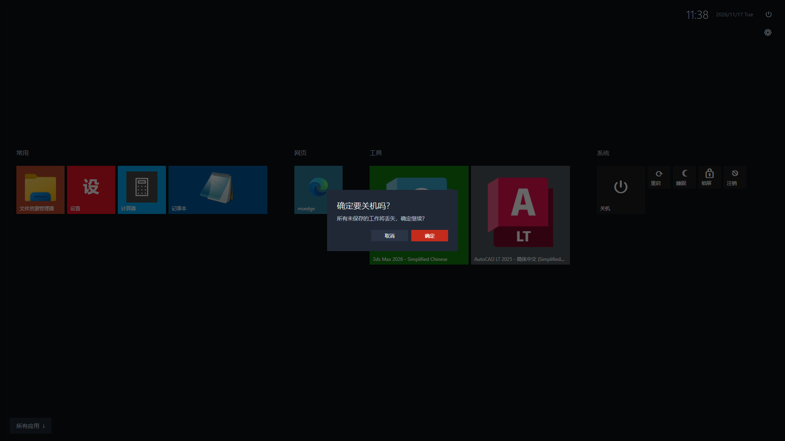
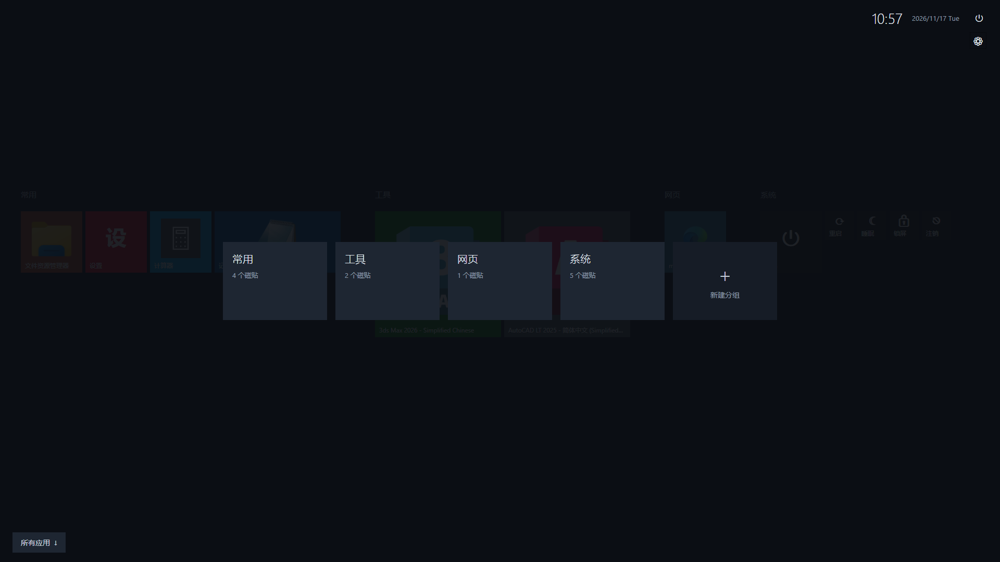

# TileStartMenu

Windows 11 上的 **Win8.1 风格全屏磁贴开始菜单**。C# / .NET 9 / WPF 原生编写，零第三方 NuGet 依赖（仅 BCL + P/Invoke）。

按 **Win 键**唤起全屏磁贴墙，替代系统开始菜单；磁贴可真实启动本机应用，底部 App Bar 操作、四档尺寸、拖拽分组、全部应用列表固定/取消固定，右上角集成电源。

> 状态：迭代至 v5（完全模仿 Win8.1 视觉规范），界面仍在持续打磨中。验收口径见 `docs/验收报告.md`，代码问题清单见 `docs/代码审查.md`。

*A Win8.1-style fullscreen tile Start Menu for Windows 11, written in C# / .NET 9 / WPF with no third-party dependencies. Pressing the Win key opens a fullscreen tile wall; tiles launch real applications; right-click raises a bottom App Bar for pin/unpin, resize and colour; power actions (shutdown / restart / sleep / lock / sign out) are built in.*

## 截图

| 磁贴墙 | 全部应用 |
| --- | --- |
|  |  |

| 右键 App Bar | 电源二次确认 | 分组总览（语义缩放） |
| --- | --- | --- |
|  |  |  |


---

## 一、Win8.1 交互对照

| 功能 | 行为 |
| --- | --- |
| 唤起 | **单按 Win 键**（左/右均可）：按下期间不碰其他键、按住 ≤700ms，即吞掉该次按键并弹出全屏菜单 |
| 全屏 | 窗口铺满整个主屏（`SM_CXSCREEN × SM_CYSCREEN`，覆盖任务栏区域），深色纯底 |
| 退出 | 四种方式：**Esc** / **再按一次 Win** / **点击窗口外空白** / 托盘退出；退出后焦点还给唤起前的前台窗口 |
| 组合键放行 | Win+R / Win+E / Win+D / Win+Shift+S 等一切 Win+字母/功能键组合**不拦截**，由钩子补送 Win 按下后原样交给系统 |
| 右键磁贴 | 屏幕**底部升起 App Bar**（不是光标旁小菜单）：取消固定 / 删除 / 调整大小 / 改颜色 / 图标规格 / 重命名；Esc 或点空白收起 |
| Pin / Unpin | 「全部应用」列表里右键 → 底部 App Bar「固定到开始菜单」，磁贴出现在墙尾；墙上右键 →「取消固定」，磁贴消失但记录保留，可再次固定 |
| 四档尺寸 | 小 1×1 / 中 2×2 / 宽 4×2 / 大 4×4，「调整大小」循环切换，网格即时重排并持久化 |
| 拖拽 | 按住磁贴移动超过 6px 进入拖拽：半透明跟随、其余磁贴实时让位预览；可换序、可拖入其他分组 |
| 分组 | 按列横向排布；右键空白墙 → 底部 App Bar「自定义」：新建分组 / 重命名分组 / 主题色 |
| 全部应用 | 左下角「所有应用 ↓」进入；按首字母分组列出本机全部可启动应用（Win32 + UWP，与系统开始菜单同源 AppsFolder，本机实测 **247 条**） |
| 电源 | 右上角 ⏻ 按钮 + 「系统」组 5 个电源小磁贴：关机 / 重启 / 睡眠 / 锁屏 / 注销；**关机与重启有二次确认** |
| 备用热键 | **Ctrl+Alt+Space**：Win 键被独占程序屏蔽时备用唤起菜单 |
| 紧急恢复 | **Ctrl+Alt+Shift+Esc**：立即卸载 Win 键钩子、恢复系统默认 Win 键行为（任务管理器也能调出） |

---

## 二、构建

前置：**.NET 9 SDK**（本项目在 SDK 9.0.302 上验证）。脚本会自动从 PATH 或标准安装位置找 `dotnet`。

```powershell
# 方式一：一键脚本（推荐，默认 Release）
powershell -NoProfile -ExecutionPolicy Bypass -File .\build.ps1

# 方式二：手动
dotnet build .\TileStartMenu.sln -c Release
```

产物：

```
src\TileStartMenu.App\bin\Release\net9.0-windows\TileStartMenu.App.exe
```

---

## 三、运行

直接双击或命令行启动 exe 即可。程序**不显示主窗口**，驻留系统托盘：

```powershell
& ".\src\TileStartMenu.App\bin\Release\net9.0-windows\TileStartMenu.App.exe"
```

- 单实例：再次启动 exe 不会开第二个进程，而是唤起已有实例并切换菜单。
- 冷启动（进程 → 钩子就绪）实测 **约 320–360ms**；Win 键 → 菜单首帧实测 **约 70–100ms**。

---

## 四、权限说明

- **不需要管理员权限。** 普通用户会话即可运行。
- Win 键接管通过 `WH_KEYBOARD_LL` 低层键盘钩子实现，普通会话可用；关机/重启所需的 `SeShutdownPrivilege` 交互式用户 token 自带。
- 已知边界：某些**全屏独占程序（部分游戏 / 全屏视频）**可能屏蔽全局热键或把菜单盖在下面；此时用：
  - **Ctrl+Alt+Space** 备用热键唤起菜单；
  - **Ctrl+Alt+Shift+Esc** 紧急卸载钩子、恢复系统 Win 键。
- 开机自启写入 `HKCU\Software\Microsoft\Windows\CurrentVersion\Run`（当前用户 hive，不需要管理员）。

---

## 五、退出与卸载

**正常退出**：右键托盘图标 →「退出」。

**紧急恢复 Win 键**：托盘 →「恢复系统默认 Win 键」，或全局按 `Ctrl+Alt+Shift+Esc`。

**完全卸载**：
1. 托盘退出程序；
2. 删除配置目录 `%LOCALAPPDATA%\TileStartMenu\`（含 `menu.json`、`icons\` 图标缓存、`appcatalog.json`、各 `.log`）；
3. 删除开机自启注册表值：
   ```powershell
   Remove-ItemProperty -Path 'HKCU:\Software\Microsoft\Windows\CurrentVersion\Run' -Name 'TileStartMenu'
   ```
4. 删除构建产物目录即可（程序不写其他位置）。

---

## 六、配置文件

路径：`%LOCALAPPDATA%\TileStartMenu\menu.json`（图标缓存在同目录 `icons\`）。写入为**原子写**（先写 `.tmp` 再 `File.Replace`）；文件损坏会自动备份为 `menu.json.broken-<时间戳>` 并重建。

| 字段 | 说明 |
| --- | --- |
| `version` | 配置格式版本 |
| `groups[]` | 分组：`id` / `name` / `order` |
| `tiles[]` | 磁贴：`id`、`name`、`kind`（Launch/File/Folder/Url/Shell）、`target`、`arguments`、`workingDirectory`、`color`(#RRGGBB)、`size`(Small/Medium/Wide/Large)、`pinned`（墙上是否显示）、`powerAction`(None/Shutdown/Restart/Sleep/Lock/SignOut)、`iconScale`(0.5/0.6/0.75/1.0)、`groupId`、`order`、`showLabel` |
| `settings.winKeyEnabled` | 是否接管 Win 键 |
| `settings.launchAtStartup` | 是否开机自启（写 HKCU Run） |
| `settings.backgroundColor` / `backgroundOpacity` | 墙底色与不透明度 |
| `settings.showClock` | 是否显示右上时钟 |
| `settings.maxTapHoldMs` | Win 键短按判定上限（默认 700ms） |
| `settings.allAppsSeeded` / `settings.seedVersion` | 种子数据迁移状态（当前 SeedVersion=2） |

日志（同目录）：`timing.log`（冷启动/唤起耗时）、`ui-debug.log`（界面调试）、`hook-debug.log`（Win 键钩子）、`icon-debug.log`（图标提取失败，无失败则不存在）、`seed-migration.log`（种子迁移记录）。

---

## 七、「全部应用」列表口径

- 枚举源：`shell:AppsFolder`，与 Win11 系统开始菜单「所有应用」**完全同源**（本机实测系统 313 条）。
- 本机四段数字：**313 → 268（名称规则剔除 45 条）→ 256（目标规则再剔 12 条 .url/.txt/.html/license 路径/https 网址）→ 247（同名合并 9 条）= 247 条**。
- 三条规则：① displayName 不含 `Uninstall/卸载/Readme/Help/许可/License/FAQ` 等垃圾项（实测命中 0）；② launchTarget 不含 `.url/.txt/.html`、license/readme 路径与 http(s) 网址型文档（实测命中 0）；③ 同名 trim 去重，Win32 优先于 UWP 壳（实测重名组 0）。
- 多语言变体（如 3ds Max 2026 的 7 种语言入口）按 `docs/全部应用过滤.md` 说明保留、不合并。
- 详细剔除与合并清单见 `docs/全部应用过滤.md`；过滤日志 `%LOCALAPPDATA%\TileStartMenu\catalog-filter.log`；可逐行核对名单 `assets/screens/allapps-names.txt`（count=247）。
- 磁贴墙首启的 6+5 个种子磁贴不受此过滤影响，硬编码生成。

## 八、已知限制

1. 视觉重做进行中：横向列布局、大图标、底部 App Bar、语义缩放（齿轮进入分组总览、拖块重排、Ctrl+滚轮）均已落地；最终 Win8.1 并排视觉对照待终验。
2. 电源功能 UI 与核心服务已接通：点电源磁贴弹二次确认浮层「确定要关机吗？…取消/确定」，取消或浮层外关闭不会误触发；真实关机/重启仍需用户在浮层上点「确定」。
3. 「全部应用」列表目前用纯色字母块占位图标，未逐个提取 256px 高清图标（墙上磁贴图标为真实 256×256 提取）。
4. 未做多显示器适配：菜单只覆盖主屏。
5. 「工具」「网页」两个空分组暂无删除入口（可重命名/新建）。
6. UWP 应用的 256px 图标提取走 Shell 路径，理论可用，尚未单独抽样验证。
